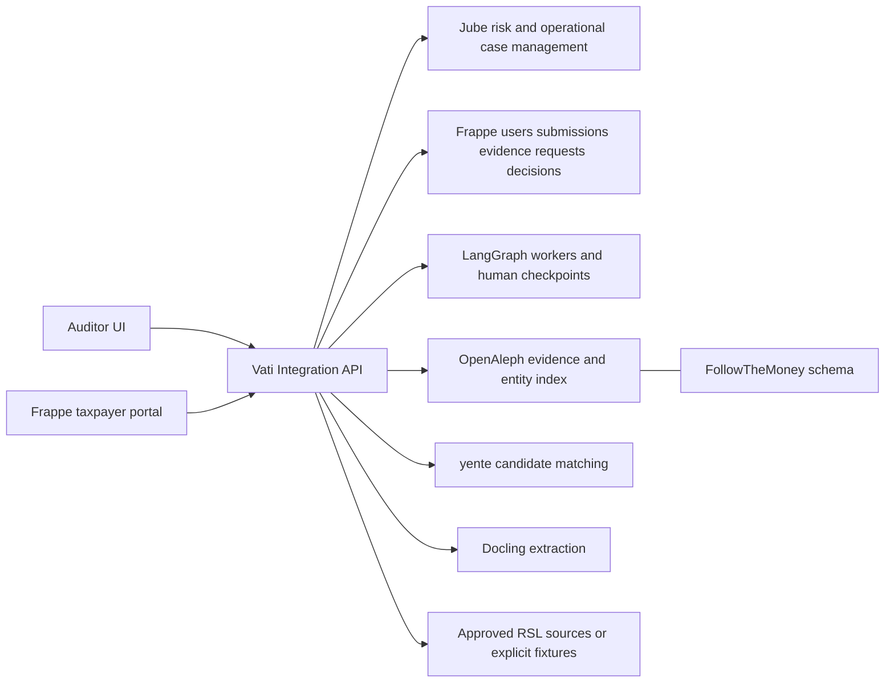

# Service architecture

## One authority per responsibility

| Responsibility | Authority | Other components |
|---|---|---|
| Operational investigation case, assignment/status/escalation, risk execution | Jube | Vati maps IDs and exposes a stable API; Frappe keeps a read projection |
| Application users, roles, taxpayer submissions, portal forms | Frappe custom app `vati_tax` | Browser sessions and Vati calls are checked against role/tenant permissions |
| Approved human decision rationale and evidence requests | Frappe custom DocTypes | Authorized actions request matching Jube transitions through Vati |
| Cross-service IDs, idempotency/outbox and normalized contracts | Vati integration layer | No competing operational case lifecycle |
| Original evidence provenance and restricted reference | Frappe/evidence store | OpenAleph search index is derived and rebuildable |
| Entity representation / relationships | FtM mappings with documented tax extensions | yente proposes candidate identity links, reviewed where ambiguous |
| AI run/checkpoint/playbook state | LangGraph worker | No direct authority to assess tax or perform enforcement |

Shared `case_id` follows every component; upstream native IDs are stored in a mapping with tenant/service uniqueness. Display IDs may be human-readable; internal UUIDs remain immutable. Updates use source/version markers and transactional delivery to prevent synchronization loops.

The first coding environment uses explicit synthetic fixtures. Live integrations graduate only after a recorded smoke test against the pinned/deployed version. A live service failure remains visible; it never silently falls back to an invented finding.

## Workflows

A submission is validated in Frappe, original evidence is hashed, and an outbox job triggers extraction/matching/risk. Jube creates or updates the operational case. LangGraph retrieves permission-scoped evidence and drafts findings, alternatives and evidence gaps. An authorized officer reviews the exact proposed action. Frappe records the decision and Vati applies the approved Jube transition idempotently.

OpenAleph native search/graph and Jube native investigation interfaces remain available to advanced analysts. Our UI presents the common workflow; do not rebuild all upstream features.

## Runtime and data separation

Use independent vendor stacks and databases. Root PostgreSQL/Redis support Vati integration development only; Frappe uses its documented database/cache configuration. Keep tenant/case access checks at the Vati boundary and in underlying Frappe/OpenAleph permissions. Deploy behind private networking/TLS; local fixture servers are loopback-only and unsuitable for production.

Approved learnings can propose a new playbook/risk version. Supervisor review, holdout evaluation and rollback are required before activation. EOI and referral packages are drafts until authorized officials act through approved channels.
