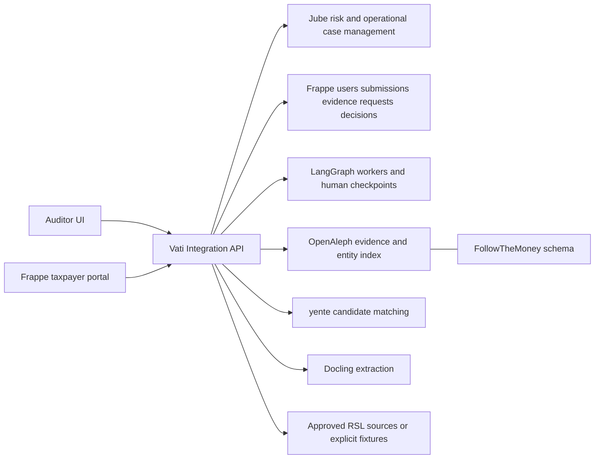
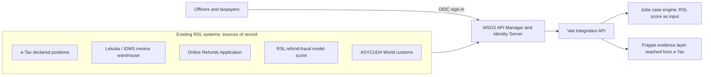
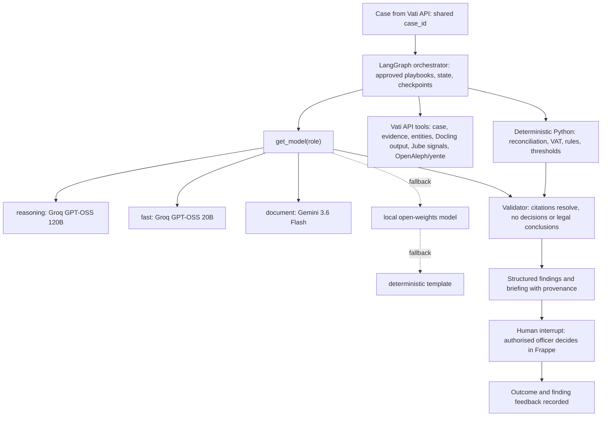

# Service architecture

## Plugging into RSL's existing systems (ADR-040)

Vati reads data RSL already holds through one versioned contract per system (TAX-111) and
never keeps a competing copy. Until RSL supplies specifications, the contracts are assumptions
and only explicit fixtures implement them. Frappe keeps roles, tenant permissions and approval
authority; WSO2 Identity Server becomes the sign-in provider once TAX-117 records a smoke test.

## One authority per responsibility

| Responsibility | Authority | Other components |
|---|---|---|
| Operational investigation case, assignment/status/escalation, risk execution | Jube | Vati maps IDs and exposes a stable API; Frappe keeps a read projection |
| Application users, roles, taxpayer evidence responses (claims are ingested from RSL, ADR-043), portal forms | Frappe custom app `vati_tax` | Browser sessions and Vati calls are checked against role/tenant permissions |
| Approved human decision rationale and evidence requests | Frappe custom DocTypes | Authorized actions request matching Jube transitions through Vati |
| Cross-service IDs, idempotency/outbox and normalized contracts | Vati integration layer | No competing operational case lifecycle |
| Original evidence provenance and restricted reference | Frappe/evidence store | OpenAleph search index is derived and rebuildable |
| Entity representation / relationships | FtM mappings with documented tax extensions | yente proposes candidate identity links, reviewed where ambiguous |
| AI run/checkpoint/playbook state | LangGraph worker | No direct authority to assess tax or perform enforcement |

Shared `case_id` follows every component; upstream native IDs are stored in a mapping with tenant/service uniqueness. Display IDs may be human-readable; internal UUIDs remain immutable. Updates use source/version markers and transactional delivery to prevent synchronization loops.

The first coding environment uses explicit synthetic fixtures. Live integrations graduate only after a recorded smoke test against the pinned/deployed version. A live service failure remains visible; it never silently falls back to an invented finding.

## Workflows

A submission is validated in Frappe, original evidence is hashed, and an outbox job triggers extraction/matching/risk. Jube creates or updates the operational case. LangGraph retrieves permission-scoped evidence and drafts findings, alternatives and evidence gaps. An authorized officer reviews the exact proposed action. Frappe records the decision and Vati applies the approved Jube transition idempotently.

OpenAleph native search/graph and Jube native investigation interfaces remain part of the intended advanced-analyst experience. Their integration is a delivery requirement, not a claim of current runtime availability. See [complete UI scope](UI_INTEGRATION_SCOPE.md) and [ADR-034](decisions/ADR-034-native-ui-integration.md): Frappe login and portals, permission-checked case-specific native links in new tabs, separate native sessions initially, and tax-specific configuration without duplicating upstream features. Native actions must preserve Frappe approval authority and case permissions.

## AI layer

Decision record: [ADR-031](decisions/ADR-031-ai-model-providers.md). LLMs reason over deterministic results and cited evidence. They never produce the figures, legal conclusions or decisions.

| Role | Implementation |
|---|---|
| Orchestration, state, tool calls, interrupts, human approval, resume | LangGraph |
| `reasoning`: investigation reasoning, hypotheses, related-party analysis, briefings | Groq GPT-OSS 120B |
| `fast`: classification, short summaries, evidence categorisation, routine tool selection, taxpayer explanations | Groq GPT-OSS 20B |
| `document`: long contracts, financial statements, reasoning over Docling output | Gemini `gemini-3.6-flash` (ADR-031) |
| Calculations, reconciliation, thresholds, rules, exact comparisons | Deterministic Python (mandatory, never an LLM) |
| PDF/OCR/table parsing | Docling via the Vati API / TAX-038 adapter |
| Keyless development and CI | `mock` provider (default) |

Agents only call `get_model(role)`. The mapping and keys live in the ignored `.env` file. Each call falls back from the hosted model to the local model to the template, and the level used is recorded and shown to the user. Every model output passes the same validator and the TAX-056 evaluation gate.

Two permission contexts share the router. **Investigation agents** (VAT refund, related party, evidence, case briefing) act for an authenticated officer and stop at a LangGraph interrupt. The **taxpayer assistant** (submission guidance, document assistance, pre-submission explanations, evidence-response drafting) acts for one taxpayer. It sees only that taxpayer's records and taxpayer-facing requests, never risk scores, internal notes or findings. It never changes declared figures or submits without the taxpayer's confirmation.

| Area | Investigation agents | Taxpayer assistant |
|---|---|---|
| AI (Gupta) | TAX-089 router, TAX-097 model reasoning, TAX-088 runtime on real cases | TAX-089 router, TAX-098 compliance assistant, TAX-099 evidence-response assistant |
| API contract (Keletso) | TAX-096 briefing, provenance and finding feedback | TAX-096 taxpayer assistance operations |
| Backend (Edga, Keletso) | TAX-086 findings record with provenance and feedback, TAX-087, TAX-090 | TAX-100 taxpayer-scoped assistant service |
| Frontend | TAX-093 briefing, model disclosure, feedback (Leseli) | TAX-101 portal assistant UI (Kananelo), TAX-078 |
| Data / QA | TAX-024 scenarios, TAX-056 evaluation | TAX-102 assistant scenarios and leakage tests (Leseli) |
| Demo | TAX-094 seed, TAX-095 keys/quota/fallback, TAX-058 | same |

## Runtime and data separation

Use independent vendor stacks and databases. Root PostgreSQL/Redis support Vati integration development only; Frappe uses its documented database/cache configuration. Keep tenant/case access checks at the Vati boundary and in underlying Frappe/OpenAleph permissions. Deploy behind private networking/TLS; local fixture servers are loopback-only and unsuitable for production.

Approved learnings can propose a new playbook/risk version. Supervisor review, holdout evaluation and rollback are required before activation. EOI and referral packages are drafts until authorized officials act through approved channels.
