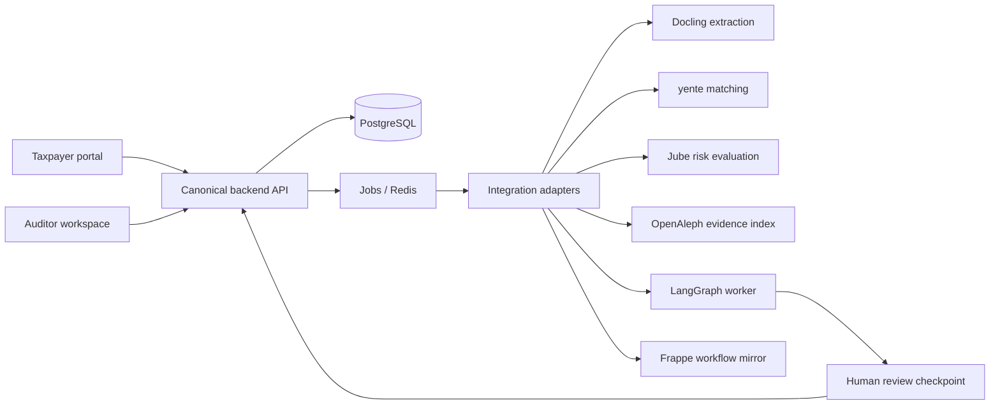

# Architecture

## Authority and ownership

The backend is the only writer of authoritative case state, decisions, permissions and the audit ledger. It validates identity and tenant membership on every request. Browsers never receive service credentials. Internal service results are validated before storage. Case ID is assigned once by the backend and mapped to each upstream identifier.

Jube returns versioned risk signals, not final tax decisions. OpenAleph holds a permission-scoped, rebuildable search/relationship projection, not the authoritative case database. FollowTheMoney is a schema/library for entities, not another server. yente similarity is a candidate match requiring corroboration. Docling extracts content with provenance. LangGraph runs approved tools with durable checkpoints and a human interrupt before decisions or outward requests. Frappe is optional case workflow/desk projection; do not create a second competing case lifecycle.

## Data flow

1. Backend validates a submission and stores the original document hash and restricted object reference.
2. Transactional outbox schedules processing; workers use an idempotency key for each service step.
3. Docling extracts, adapter maps entities into FollowTheMoney, yente produces candidates and OpenAleph indexes approved records.
4. Jube evaluates configured synthetic risk rules. Backend normalizes findings and records model/rule version.
5. LangGraph gathers evidence and drafts cited findings. Missing/contradictory evidence routes to review.
6. Authorized auditor records a decision and reasons; backend emits an audit event and synchronizes optional Frappe state.

## Failure and security design

Bound every outbound request, retry only safe/idempotent operations with backoff, and retain failed jobs for visible manual retry. Deduplicate on tenant + source + event ID. A retry cannot repeat an approved outward action. Use tenant-scoped credentials/collections and authenticated worker calls. Store extracted document content and model context as sensitive; never embed secrets in traces. Uploads require size/type checks and malware scanning before production. Keep provider processing local by default; external models require an approved data policy.

## Stack choices

PostgreSQL + Redis form the runnable local infrastructure. Frontend framework and backend implementation are left to TAX-001/003/005 rather than imposing a conflicting stack. LangGraph is an embedded Python workflow library served by the AI worker, not an assumed hosted service. Each heavyweight upstream runs its own supported deployment stack; adapter configuration connects it. No forks are currently needed.
